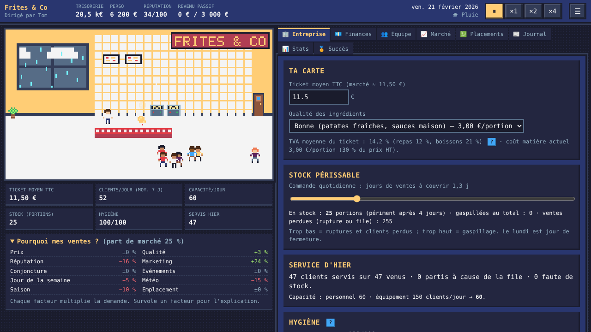
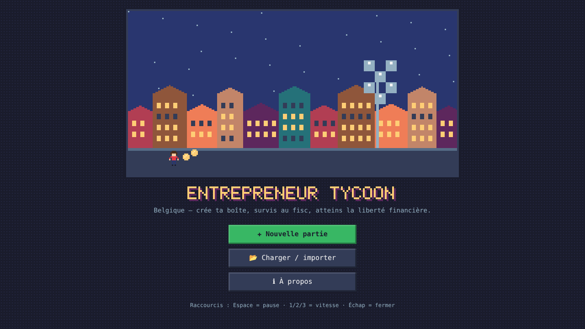
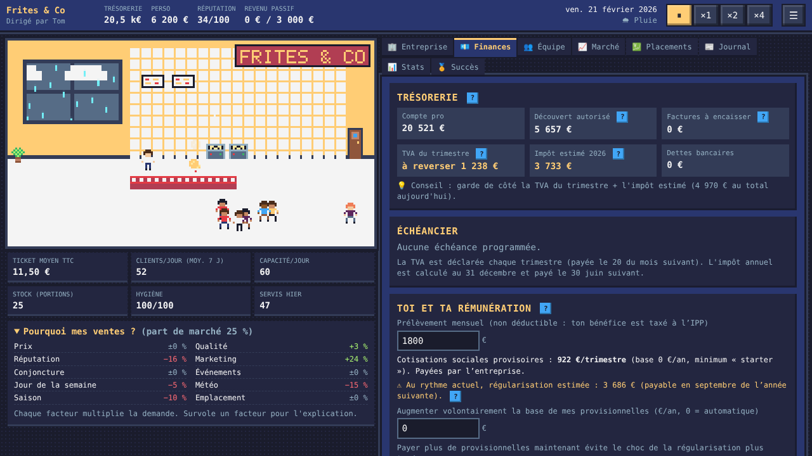
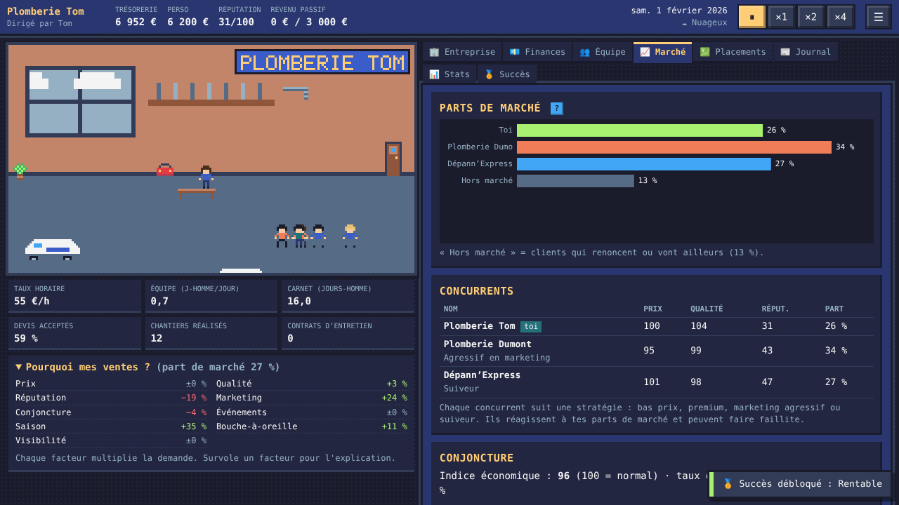
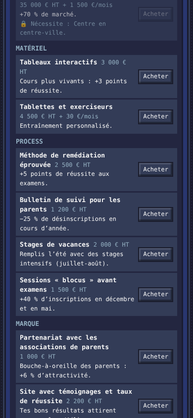

# Entrepreneur Tycoon (Belgique)

Un jeu de gestion en pixel art, jouable dans le navigateur, où tu crées ton
entreprise belge, survis à la TVA, aux cotisations sociales et à l'impôt, puis
construis des revenus passifs jusqu'à la **liberté financière**.



- **5 secteurs aux mécaniques différentes** : agence web (heures et projets,
  puis SaaS), friterie (stock périssable, météo, AFSCA), e-commerce (publicité,
  conversion, stock, retours), artisan plombier/électricien (devis, chantiers,
  camionnettes, TVA 6 %), centre de soutien scolaire (calendrier scolaire,
  résultats aux examens).
- **Indépendant ou SRL**, avec une fiscalité belge simplifiée mais crédible :
  TVA trimestrielle, cotisations sociales et régularisation, IPP, ISOC,
  rémunération du dirigeant, dividendes (VVPR-bis), placements (TOB, taxe sur
  les plus-values 2026…). Tous les taux sont dans
  [`src/data/fiscalite.js`](src/data/fiscalite.js), avec leur source et la
  mention « à vérifier ».
- Employés, prêts, investisseurs, 2 à 4 concurrents IA, **92 événements**,
  inflation et indexation des salaires, 42 succès.
- Bourse (ETF, actions), épargne, immobilier locatif ; victoire quand ton
  revenu passif atteint l'objectif (3 000 €/mois par défaut), puis bac à sable.
- Faillite ? Un **post-mortem** explique les causes et donne des conseils.
- Pixel art, police pixel et sons générés par le code : aucun fichier externe.

| | |
|---|---|
|  |  |
|  |  |

## Jouer

**En ligne** : une fois GitHub Pages activé (voir plus bas), le jeu est à
l'adresse `https://<ton-pseudo>.github.io/<nom-du-dépôt>/`.

**En local** : télécharge le dépôt et ouvre `index.html` dans ton navigateur.
C'est tout : pas d'installation, pas d'Internet nécessaire.

### Commandes

| Touche | Effet |
|---|---|
| Espace | Pause / reprise |
| 1, 2, 3 | Vitesse ×1, ×2, ×4 (1 mois ≈ 60 s à ×1) |
| Échap | Fermer une fenêtre |
| Flèches | Changer d'onglet (quand un onglet a le focus) |

### Conseils pour débuter

1. Commence petit : regarde le panneau **« Pourquoi mes ventes ? »**.
2. Dans **Finances**, surveille la **TVA du trimestre** et l'**impôt estimé** :
   ils arrivent après l'encaissement.
3. Recrute quand tu es saturé, pas avant.
4. Pour gagner : recrute un·e **gérant·e**, retire-toi de l'opérationnel
   (onglet Équipe), sors l'argent de l'entreprise et place-le (onglet
   Placements).

Les sauvegardes sont automatiques (navigateur) ; tu peux aussi sauver dans 3
emplacements et **exporter/importer un fichier JSON** (menu ☰).

## Déployer sur GitHub Pages

1. Pousse le dépôt sur GitHub (branche `main`).
2. Sur GitHub : **Settings → Pages → Source : « GitHub Actions »**.
3. Le workflow [`.github/workflows/pages.yml`](.github/workflows/pages.yml) teste puis publie le jeu à chaque push ; l'adresse s'affiche dans l'onglet **Actions**.

## Pour développer

Aucune dépendance. Il faut seulement [Node.js](https://nodejs.org) ≥ 20.

```bash
node --test                      # tous les tests (moteur, fiscalité, événements, sauvegardes…)
node tools/simulate.js           # simulation de centaines de parties par des bots
node tools/simulate.js --games 20 --sectors restaurant --difficulties realiste
node tools/trace.js agence realiste optimale srl 1 15   # une partie de bot, année par année
node tools/bundle.js             # régénère dist/tycoon.bundle.js après une modification de src/
npx http-server -p 8080 .        # (optionnel) servir le jeu en http://localhost:8080
```

> Après avoir modifié un fichier de `src/`, lance `node tools/bundle.js` : le
> fichier `dist/tycoon.bundle.js` sert à jouer en ouvrant `index.html` sans
> serveur (les navigateurs bloquent les modules ES en `file://`). Un test vérifie
> qu'il est à jour.

### Organisation

```
src/engine/    logique pure (aucun DOM, aucun Math.random) : tick(state, dt, rng) déterministe
src/data/      configuration : secteurs, fiscalité, événements, succès, équilibrage
src/storage/   SaveAdapter (+ LocalStorageAdapter) : un adaptateur cloud pourra s'ajouter en V2
src/ui/        interface (écrans, onglets, scène pixel art, graphiques, sons)
tests/         node --test
tools/         simulate.js (bots), trace.js, bundle.js
docs/          DESIGN.md, BALANCE.md, V2.md, ROADMAP.md
```

- [docs/DESIGN.md](docs/DESIGN.md) — conception, formules, décisions
- [docs/BALANCE.md](docs/BALANCE.md) — résultats d'équilibrage par simulation
- [docs/V2.md](docs/V2.md) — comptes Google, sauvegarde cloud, classement, anti-triche
- [docs/ROADMAP.md](docs/ROADMAP.md) — feuille de route

## Avertissement

La fiscalité est **simplifiée** et les chiffres 2026 viennent de sources
secondaires : c'est un jeu pédagogique, pas un outil de calcul. Vérifie toujours
auprès du SPF Finances, de ta caisse d'assurances sociales ou d'un comptable.

## Licence

MIT.
